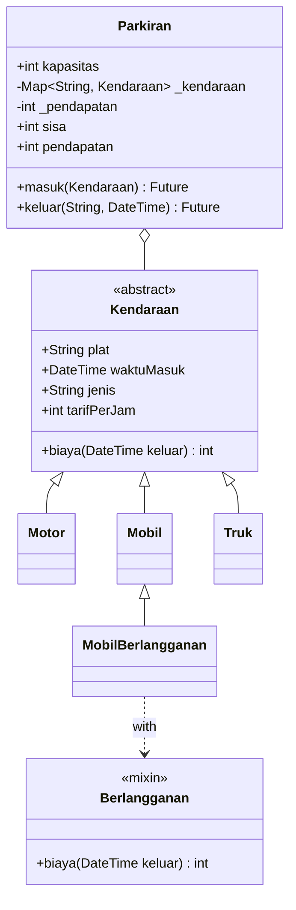
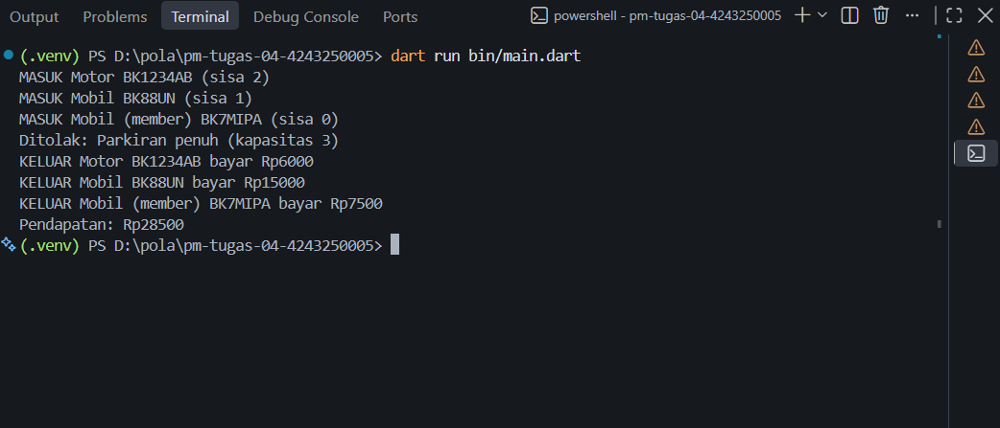

# Tugas Rutin 4 — Sistem Parkir Kampus

**Nama:** Christian Nicholas Sinaga  
**NIM:** 4243250005  
**Kelas:** PSIK 24C

## Deskripsi

Program console mensimulasikan palang parkir kampus dengan kapasitas tiga
kendaraan. Tarif per jam: Motor Rp6.000, Mobil Rp15.000, dan Truk Rp30.000.
Biaya dibulatkan ke atas per jam dengan minimum satu jam. Mobil berlangganan
mendapat potongan 50% dari total biaya.

## Diagram kelas



## Menjalankan dan memeriksa

Jalankan dari folder proyek:

```powershell
dart pub get
dart run bin/main.dart
dart analyze
dart test
```

Program otomatis memperagakan tiga kendaraan masuk, satu kendaraan ditolak
karena kapasitas penuh, lalu kendaraan yang parkir keluar.

## OOP dan asynchronous programming (100–200 kata)

Di `lib/kendaraan.dart`, `Kendaraan` adalah abstract class dengan data plat
dan waktu masuk yang final, getter jenis/tarif, serta method biaya. `Motor`,
`Mobil`, dan `Truk` mewarisi kontrak tersebut dengan tarif berbeda. Method
`biaya` dioverride oleh mixin `Berlangganan`, yang dipakai oleh
`MobilBerlangganan` untuk memberi diskon 50%. `lib/parkiran.dart` menerapkan
enkapsulasi melalui map privat `_kendaraan` dan nilai privat `_pendapatan`;
keduanya diakses melalui getter `sisa` dan `pendapatan`. `ParkirPenuh`
merupakan exception khusus saat kapasitas habis. Di `bin/main.dart`, sebuah
`List<Kendaraan>` berisi beberapa subclass menunjukkan polymorphism: `Parkiran`
memanggil getter dan method kendaraan tanpa memeriksa tipe konkret.
Method `masuk` dan `keluar` bertipe `Future` dan memakai `async`/`await` pada
`Future.delayed` untuk mensimulasikan palang. Setiap transisi menyiarkan pesan
melalui `StreamController.broadcast()`; listener di `main` menampilkan
urutannya di terminal.

## Bukti tangkapan layar

Jalankan `dart run bin/main.dart` dan ambil tangkapan layar terminal yang
memperlihatkan kendaraan masuk, penolakan saat penuh, kendaraan keluar, serta
total pendapatan. Simpan sebagai `screenshots/simulasi-parkir.png`.



## Penggunaan AI

AI digunakan sebagai bantuan untuk menyusun implementasi, tes, dan draf README.
Program diperiksa dengan `dart analyze` dan `dart test`.

## Pengumpulan

Buat repository GitHub publik bernama `pm-tugas-04-4243250005`, pastikan
memiliki sedikitnya tiga commit, lalu kirim tautannya melalui LMS UNIMED.
